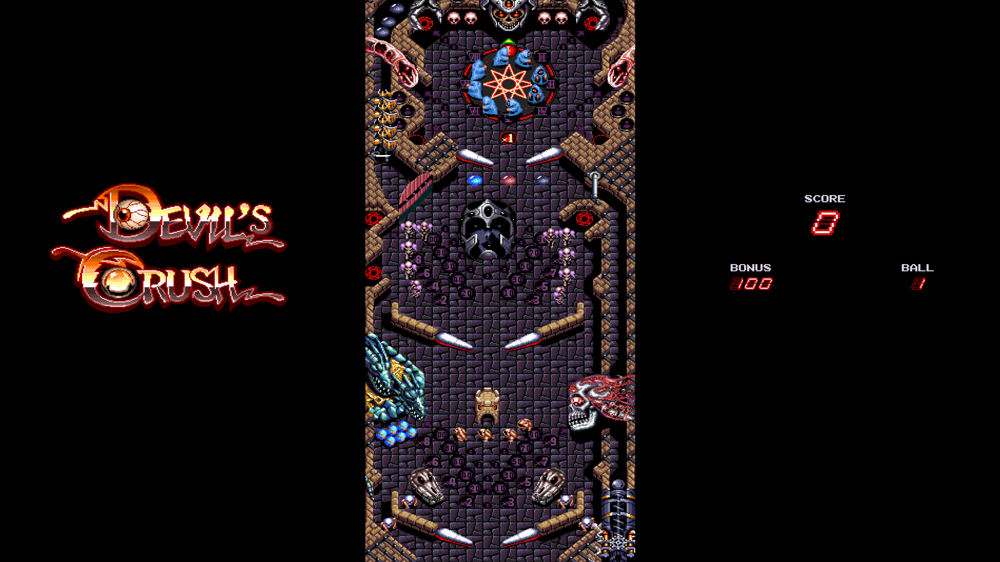

# Devil's Crush Port

An unofficial PC port of the 1990 TurboGrafx-16 pinball game *[Devil's Crush](https://en.wikipedia.org/wiki/Devil%27s_Crush)*, built to be played on a virtual pinball cabinet.

It plays like the original game, with some additional features:

* Cabinet mode shows the whole table at once, with the playfield, backglass, and score in their own windows
* Creatures and targets across the table stay active in cabinet mode, instead of only those near the ball
* Smoother motion on high refresh rate displays
* Analog plunger and accelerometer nudging (verified working on PinOne boards)
* Adjustable nudge strength
* Music keeps all of its parts while sound effects play
* High scores are saved between sessions

## ROM (Required)

No game data is included.

You will need to obtain a copy of the original ROM:

| | |
| --- | --- |
| Region | USA |
| Size | 393,216 bytes |
| MD5 | `92fbe89d4c87bf283dbfbeac69a64e6e` |
| SHA-1 | `1c54fb80e5acf82d7346dd7f2e8db8c74c58f4ba` |
| SHA-256 | `9ad122903ec34cb8e62ba1aae1cfddbfcb06657d0fba55d6d0b1d280f88e30f9` |

## Playing

Run `devils-crush-launcher.exe`.

Choose your ROM file under game settings, change any other setting you like, then press **Play**.

| Input | Action |
| --- | --- |
| Left Shift / Left | Left flipper |
| Right Shift / Right | Right flipper |
| Enter | Launch the ball, start, pause, confirm |
| Space | Nudge |
| F5 / F9 | Quick save / quick load |
| Escape | Exit |

## Port Progress

The port is fully playable, but is a work in progress.

TurboGrafx-16 hardware is still partially emulated, and the game's own logic is being progressively replaced with native C++ validated against original ROM execution.

## Credits

* [Beetle PCE](https://github.com/libretro/beetle-pce-libretro) - used to emulate the original hardware
* [Mesen](https://github.com/SourMesen/Mesen2) - used to validate the port
* [SDL](https://github.com/libsdl-org/SDL) - windows, input and audio
* [stb](https://github.com/nothings/stb) - launcher text
